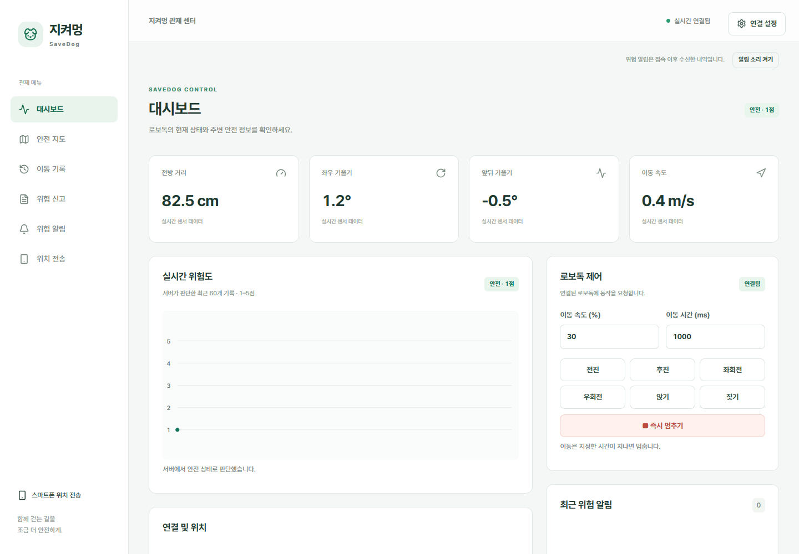

# 지켜멍

로보독 한 대의 센서·위험도·이동 경로를 확인하고 신고를 검토하는 React + TypeScript 클라이언트입니다.

## 실행

Node.js 22.12 이상이 필요합니다. CI는 Node.js 24를 사용합니다.

```bash
npm ci
cp .env.example .env
npm run dev
```

PowerShell에서는 `Copy-Item .env.example .env`로 복사합니다. `.env`에서 API 주소와 카카오 JavaScript 키를 설정한 뒤 개발 서버를 다시 실행합니다.

| 환경 변수 | 용도 | 기본값 |
| --- | --- | --- |
| VITE_API_BASE_URL | API 서버 주소 | http://localhost:8080 |
| VITE_WS_URL | 별도의 STOMP 접속 주소 | API 주소의 /ws |
| VITE_KAKAO_MAP_APP_KEY | 카카오 지도 JavaScript 키 | 미설정 |

관제·장치 토큰은 화면 우측의 **연결 설정**에서 입력합니다. 토큰은 메모리에만 유지하고 새로고침하면 지웁니다. 환경 변수나 소스에 토큰을 넣지 않습니다. 관제 요청과 STOMP CONNECT는 Bearer 토큰, 스마트폰 위치 전송은 X-Device-Token을 사용합니다.

서버의 CORS_ALLOWED_ORIGINS에 실제 프론트 주소를 등록해야 합니다. 기본 허용 주소는 http://localhost:3000과 http://localhost:5173입니다. 카카오 개발자 콘솔에도 프론트의 사이트 도메인을 등록해야 지도가 표시됩니다. 카카오 키 없이도 다른 화면은 사용할 수 있습니다.

## 화면

| 주소 | 기능 | 명세 |
| --- | --- | --- |
| / | 실시간 센서·위험도·연결 상태·로보독 제어 | F-01, F-04, F-06, F-11, F-12 |
| /map | 현재 위치·위험 구간·신고 위치·안전/최단 경로 | F-07, F-08, F-09, F-10 |
| /history | 기간별 센서·위험도·좌표 기록 | F-05 |
| /reports | 신고 상세·사진·접수번호 등록·기각 | F-13, F-14 |
| /alerts | 접속 후 수신한 위험 알림 | F-16 |
| /location | 스마트폰 GPS 전송·화면 꺼짐 방지 | F-15 |

기존 /routes와 /statistics 주소는 각각 /map과 /history로 이동합니다.

- 거리 단위는 cm, 기울기는 °, 속도는 m/s입니다. 위험도는 서버가 판단한 1–5점을 그대로 표시합니다.
- 값이 없으면 `값 없음`으로 표시합니다. 센서는 3초, GPS는 5초 이상 갱신되지 않으면 끊김으로 표시합니다. 서버가 시간대 없는 시각을 반환하므로 서버와 브라우저의 시간대 및 시계를 맞춰 사용합니다.
- 실시간 연결은 /ws의 STOMP를 사용합니다. 센서·연결 상태·신고·위험 알림 네 토픽을 구독하고, 끊기면 5초 간격으로 재접속한 뒤 상태와 신고를 다시 조회합니다.
- 위험 배너는 서버의 robotStopped가 false면 긴급 상태로 표시합니다. 알림 소리는 사용자가 버튼을 눌러 켭니다. 알림 내역은 접속 중에만 메모리에 남습니다.
- 로보독 명령의 202 응답은 전송 완료를 뜻합니다. 실제 동작 완료를 뜻하지 않습니다. 이동 명령은 기본 1초로 제한하며 즉시 멈추기 버튼을 제공합니다.
- 지도는 수집된 길만 사용합니다. 안전 우선은 위험 구간을 피하고, 최단 거리는 위험도를 고려하지 않습니다. 수집된 길이 없으면 서버의 경로 없음 안내를 표시합니다.
- 이동 기록은 기간 미지정 시 최근 1,000건, 지정 시 최대 10,000건을 조회하고 화면에서는 50건씩 나눠 보여줍니다.
- 민원 창구 자동 연동은 아직 없습니다. 관제자가 직접 접수한 뒤 받은 접수번호로 제출 완료를 기록합니다. 승인 대기·제출 실패 상태에서만 등록 또는 기각할 수 있습니다. 충돌 시 최신 상태를 다시 조회합니다.
- 카메라는 보류된 선택 기능입니다. 사용자가 켜면 3초마다 최신 프레임의 presigned URL을 조회합니다. 신고 사진 URL은 화면을 열 때와 4분마다 새로 조회합니다. S3 미설정 또는 사진 없음은 별도로 안내합니다.

## 스마트폰 위치 전송

스마트폰에서 /location을 열고 연결 설정에 서버 주소와 장치 토큰을 넣습니다. **위치 전송 시작**을 눌러 권한을 허용하고 페이지를 켜둡니다. 위치 오차가 30m를 넘으면 전송하지 않고 정확한 위치를 기다립니다. 전송 중지 또는 화면을 나갈 때 위치 추적을 해제합니다.

위치 기능은 HTTPS 또는 localhost에서만 사용할 수 있습니다. HTTPS 화면에서는 API와 WebSocket도 HTTPS/WSS로 제공해야 합니다. 스마트폰에서 localhost는 스마트폰 자신을 가리키므로 PC의 서버 주소나 HTTPS 도메인을 사용합니다. 화면 꺼짐 방지는 지원되는 브라우저에서만 켜집니다. 위치 전송만으로 이동 기록이 만들어지지는 않으며 아두이노·로보독의 센서 전송이 함께 필요합니다.

## 코드 구조

- src/api: API 요청, 서버 타입, STOMP 구독
- src/app: 공유 상태와 서버 연결 설정
- src/features: 화면별 기능
- src/components: 공통 표시 요소
- src/test: 테스트 설정과 테스트 데이터

## 확인

```bash
npm run format:check
npm run lint
npm test
npm run build
```

API 인증·오류 처리, 늦은 응답과 실시간 메시지 충돌, 신고 처리, 경로 요청, GPS 정확도·권한 거부·중지 등을 테스트합니다. PR에서는 같은 검사를 CI로 실행합니다.

브라우저 검증은 로컬 테스트 응답으로 REST/STOMP 대시보드, 명령 전송, 신고 양식과 모바일 화면을 확인했습니다. 아래 이미지는 테스트 데이터 화면입니다. 실제 서버·로보독·스마트폰 GPS·카카오 지도 키·S3 환경에서의 통합 검증은 별도로 필요합니다.



## 협업 규칙

이슈 → dev에서 작업 브랜치 생성 → 작은 단위 커밋 → dev 대상 PR 순서로 진행합니다. main은 배포용이며 모든 작업은 dev를 거칩니다. PR은 검토 전 머지하지 않습니다.

- 커밋: `type :: 작업내용 #이슈번호`
- PR: `[type/#이슈번호] 작업 내용`
- 이슈: `[type] 작업 내용`
- 브랜치: `feature/작업내용`, `refactor/작업내용`, `fix/작업내용`
- 이슈와 PR 담당자: jiwoo1222
- 신규 기능·개선 라벨: enhancement, 오류 수정 라벨: fix

기준 문서: [기능명세서](https://app.notion.com/p/5816c08297988393808b81fbe59d546e), [API 상세](https://app.notion.com/p/5d06c08297988251bcb60160b41ad174), [카카오 지도 SDK](https://apis.map.kakao.com/web/documentation/)
